# MeetRecap

MeetRecap turns meeting notes into a summary, decisions, action items, next steps, and a follow-up email. Output can be English, Arabic, or Urdu.

## Screenshots

| Feature | Screen |
| --- | --- |
| Notes, English | 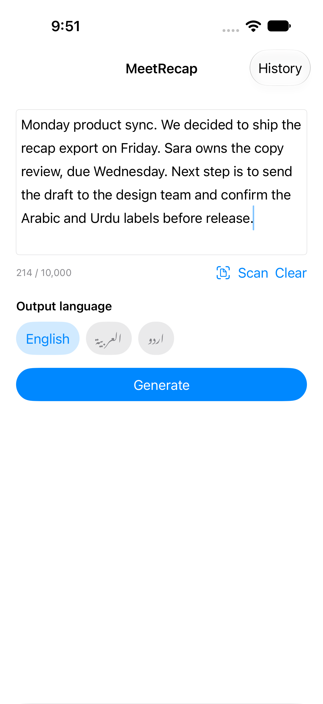 |
| Arabic, right to left | 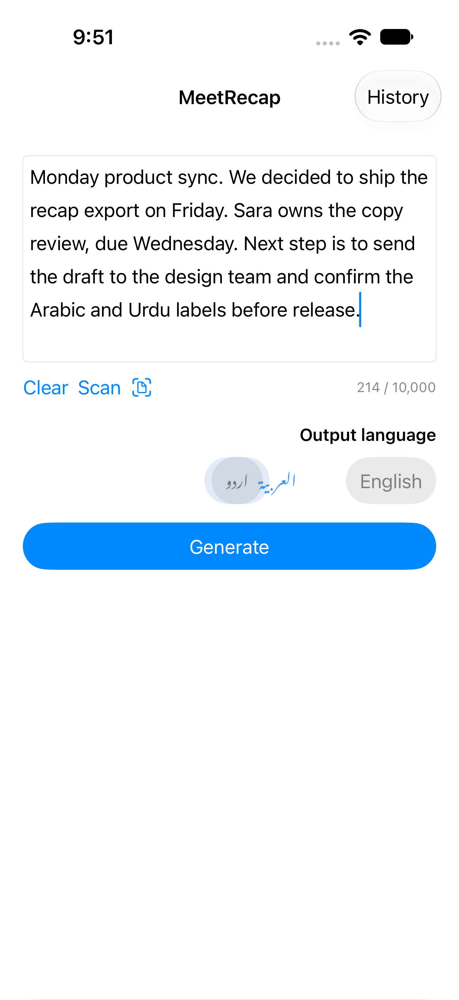 |
| Urdu, right to left | 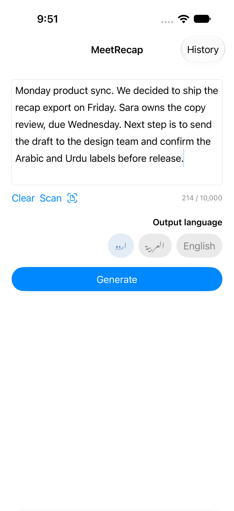 |
| English recap |  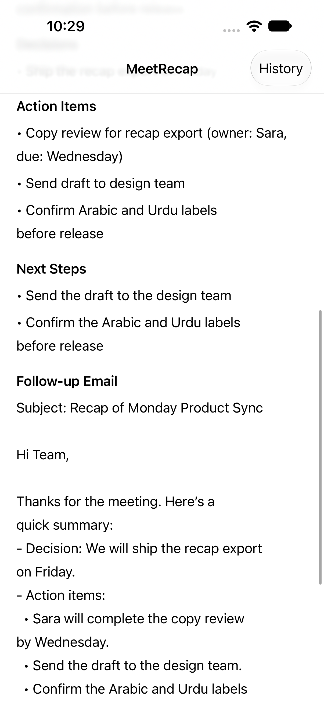 |
| Copy | 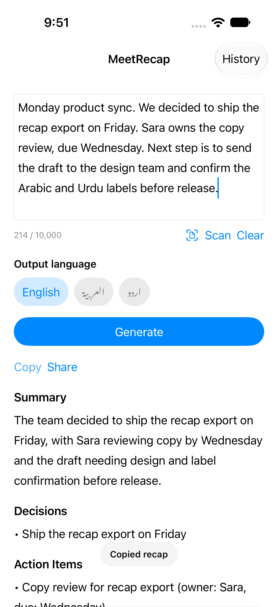 |
| Share | 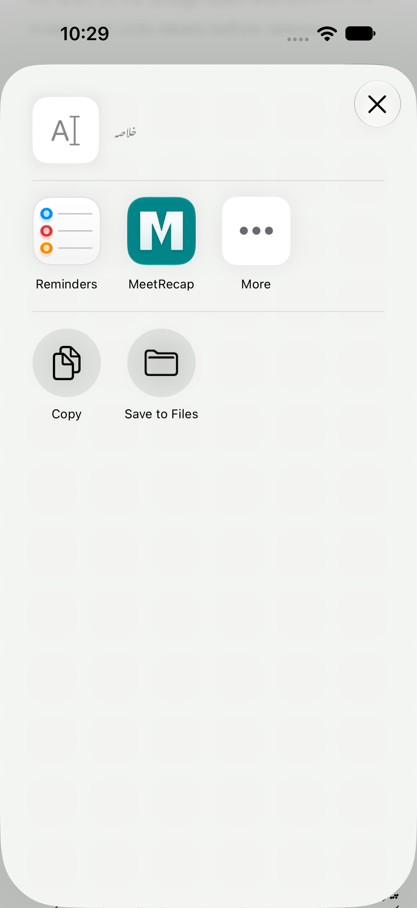 |
| Arabic recap | 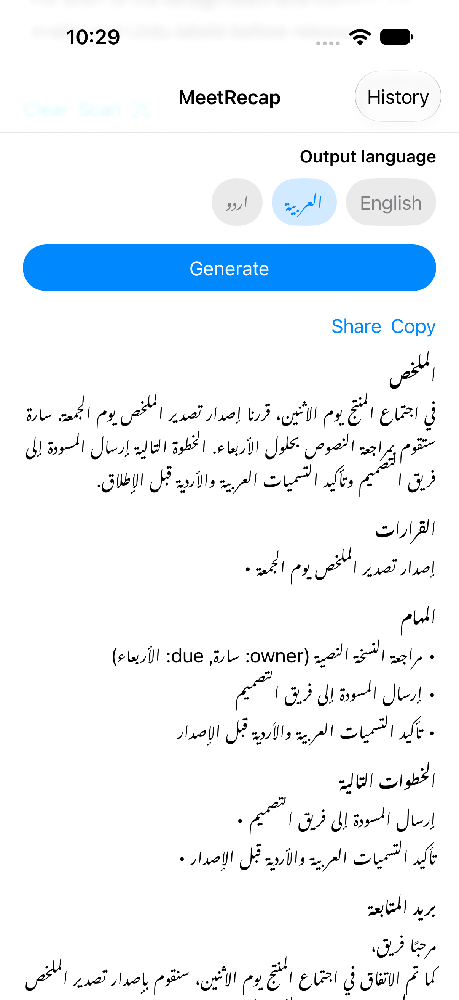 |
| Urdu recap | 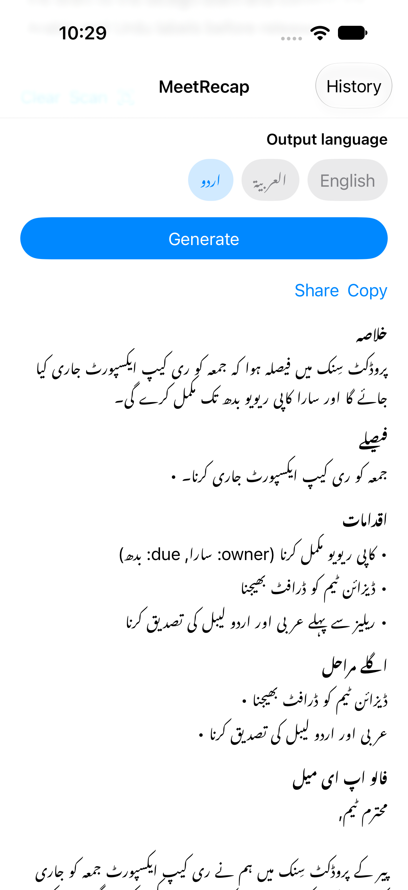 |
| Choose a photo | 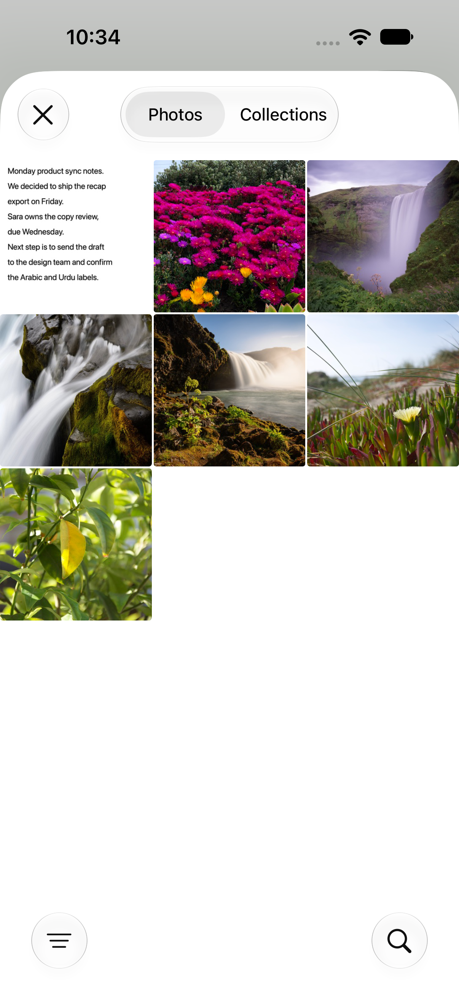 |
| Scanned text | 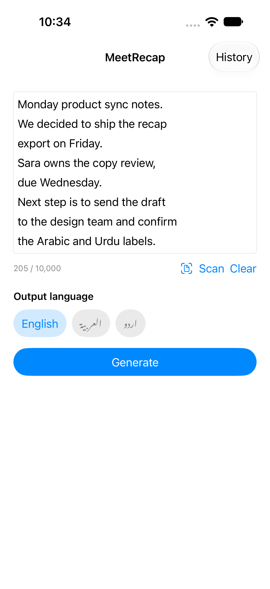 |
| History | 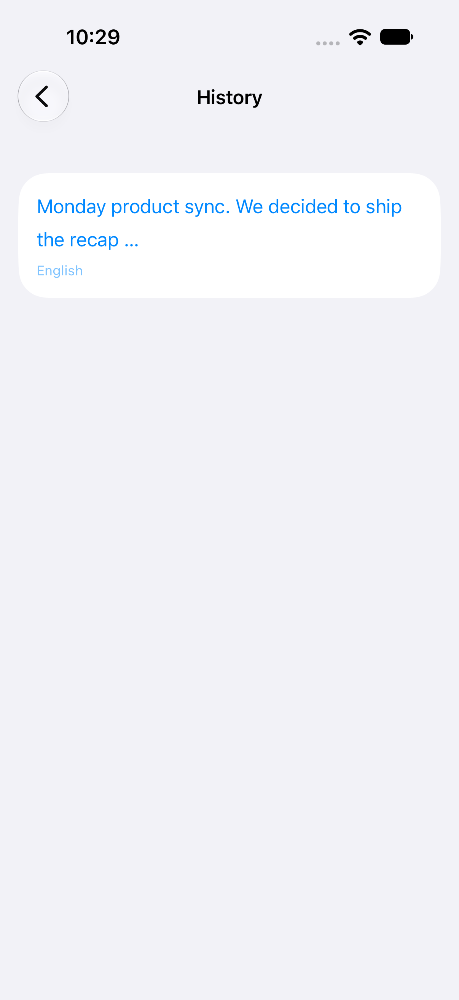 |
| Open a saved recap | 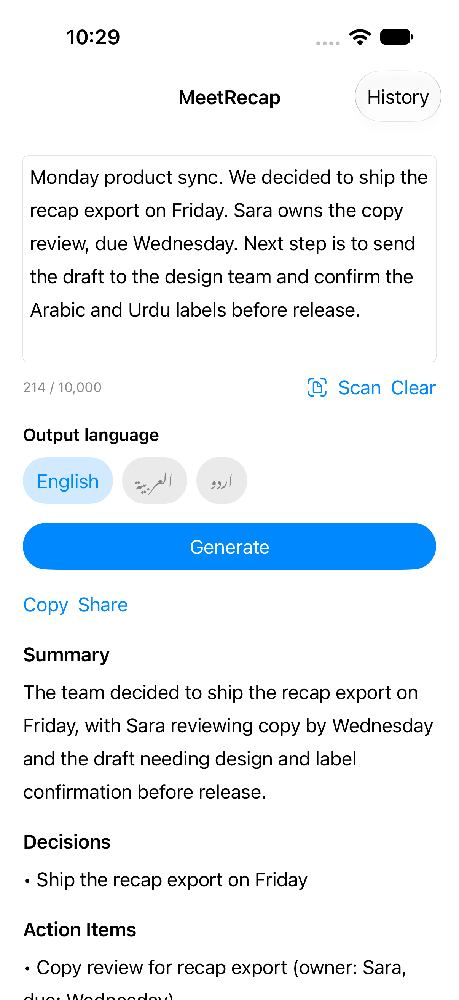 |
| Delete confirmation | 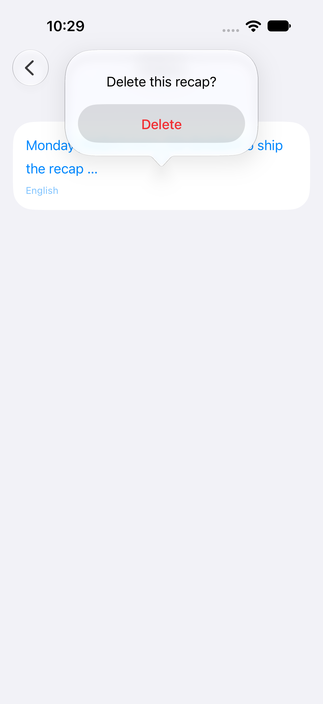 |
